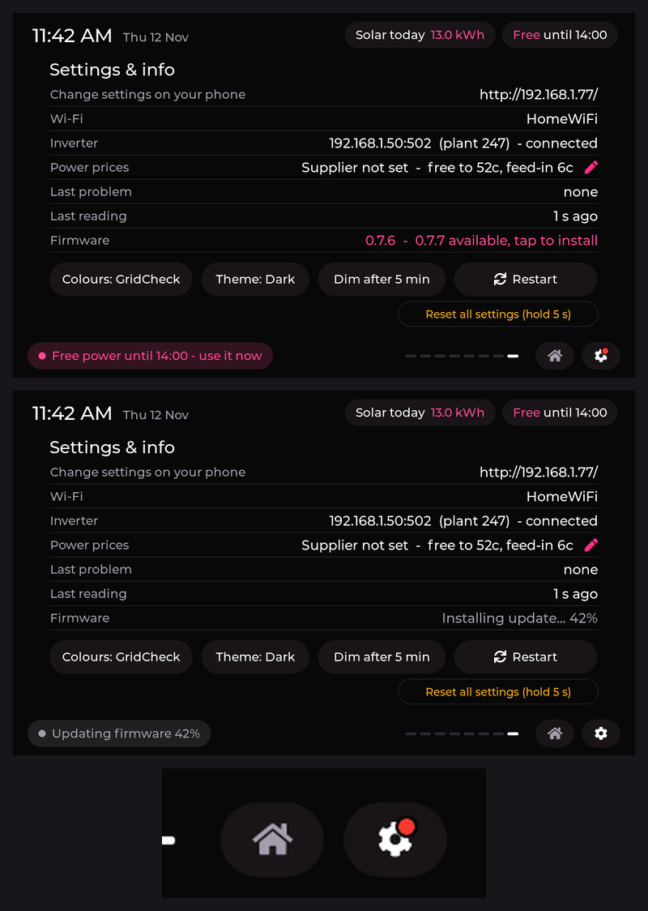
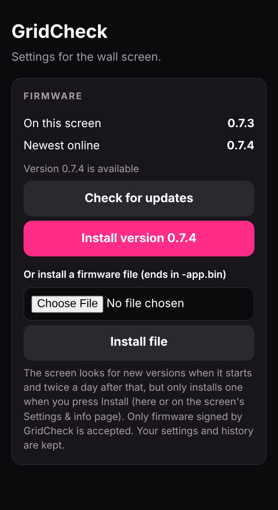
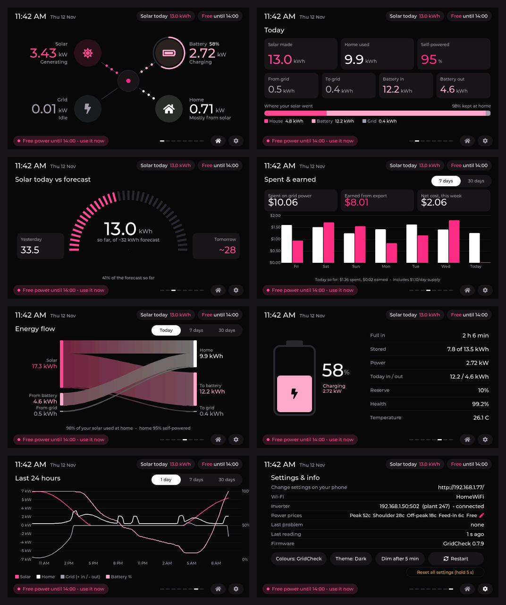
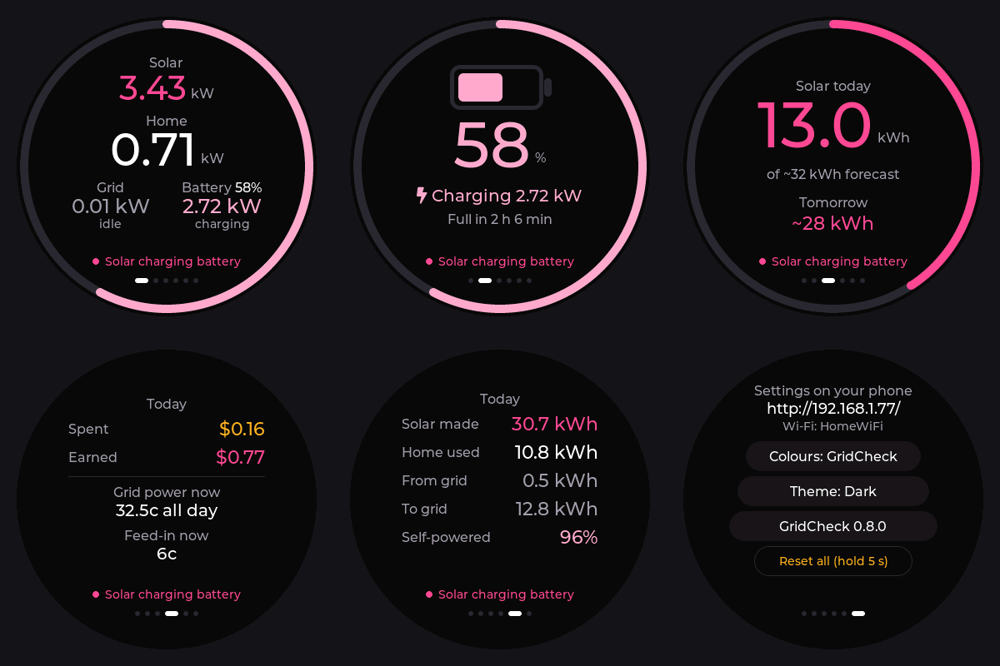
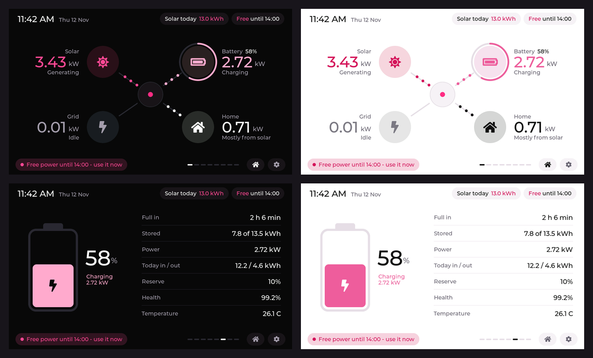

# GridCheck Screen

A wall display for **Sigenergy** solar and battery systems, running on the **Waveshare ESP32-S3-Touch-LCD-7B** (7", 1024×600) or the round **Waveshare ESP32-S3-Knob-Touch-LCD-1.8** (1.8", 360×360, with a turning knob; the **1.8B** is the black-case version). It reads your inverter over Modbus TCP on your own Wi-Fi: no cloud, no account, no PC once it's installed.


*Rendered from the firmware's own screen code on a PC (see `sim/`), not a photo of the board.*

## Install

**[Install page](https://mrdinte.github.io/GridCheck_Screen/)**: open it in Chrome or Edge on a computer, plug the board's **UART** USB-C port in and press **Install GridCheck**.

- **New screen:** tick **Erase device**.
- **Already running GridCheck:** leave it unticked so your Wi-Fi and settings are kept.

Then join the **GridCheck-Setup** Wi-Fi from your phone to choose your home Wi-Fi and enter the inverter's IP address. Modbus TCP must be switched on for the inverter (your installer does this in the mySigen app).

## Updates over Wi-Fi

From version **0.5.0** on, the screen updates itself over Wi-Fi. Install 0.5.0 or later over USB **once**; after that:

- The screen checks this site when it starts and then twice a day for a newer version (or any time you press **Check for updates**). A red dot on the Settings button shows when one is available. It **never installs on its own**.
- To install, either:
  - tap **Firmware** on the screen's **Settings & info** page, then tap again to confirm; or
  - press **Install update** on the phone settings page (the address is shown at the bottom of the screen).
- The phone page can also install a firmware file you downloaded (the one ending in `-app.bin`).
- Settings and history are kept. If a new version doesn't start properly, the screen goes back to the previous one by itself.





*Screen: a newer version is available (red dot on the Settings button, "tap to install" on the Firmware row), then installing over Wi-Fi. Phone: the Firmware card on the settings page.*

### Security

How updates are protected, and the limits, are explained in full in **[TECH_NOTES.md](TECH_NOTES.md)**. In short:

- **Signed updates.** Every update must be signed with GridCheck's private key, which is not in this repository. The screen checks the signature against the public key built into its firmware (`src/signing_pub.h`) before it will switch over. A file that is unsigned, signed with another key, or changed by even one bit is refused. That holds even if someone gets into this GitHub account, or uploads a file from inside your network.
- **No going back to old versions.** The screen refuses an older release than the one it's running (the version is read from inside the signed file, so it can't be faked).
- **Nothing is opened to the internet.** The screen only makes outgoing HTTPS requests (certificate checked) to this site and to Open-Meteo for the forecast. Nothing outside your network can connect to it.
- **Set a settings PIN** on the phone page. It protects changing settings and installing updates from your home network.
- **No updates through the setup hotspot.** The `GridCheck-Setup` hotspot has no password, so the screen refuses firmware uploads while it is open.
- **Read-only.** The screen only *reads* the inverter (Modbus function 4). It never sends commands to it.
- **USB is physical access.** Anyone holding the board can re-flash it over USB. As with any device in your home, keep it where you'd keep your router.

## What it shows



Swipe between eight pages, tap a page dot to jump to one, or use the **Home** and **Settings** buttons at the bottom right of every page:

1. **Now**: solar, battery, grid and home power around a hub, with moving dots, the battery ring and a status line. Tap an icon to open its page.
2. **Today**: solar made, home used, % self-powered, grid in/out, battery in/out, and where your solar went.
3. **Solar vs forecast**: today's solar against the Open-Meteo forecast (or your 7-day average), with yesterday and tomorrow.
4. **Spent & earned**: dollars spent on grid power and earned from export per day, for 7 or 30 days.
5. **Energy flow**: a Sankey diagram of where energy came from and went, for today, 7 or 30 days.
6. **Battery**: a battery that fills up with the charge level, time to full or empty, stored kWh, today in/out, reserve, health and temperature.
7. **History**: the last 24 hours of power, or daily totals for 7 or 30 days.
8. **Settings & info**: phone settings address, Wi-Fi, inverter connection, **Power prices** (tap to choose your grid supplier, set Peak and Off-peak times, set when feed-in is paid and any daily limit, and change each price), firmware updates, and buttons for **Colours**, **Theme**, **screen timeout**, **Restart** and **Reset all settings** (hold 5 s).

### The round knob screen (1.8")



**Turn the knob** (or swipe) to go through seven pages: **Now** (solar, home, grid and battery), **Battery** (a battery that fills up, time to full or empty), **Solar** today against the forecast, **Money** (spent and earned today, the grid price and feed-in right now), **Today**'s energy, and **Settings** (the phone settings address, **Change Wi-Fi**, colours, theme, firmware updates, reset). **Change Wi-Fi** opens the screen's setup hotspot straight away and shows a QR code: scan it with your phone to join, pick the new Wi-Fi on the page that opens and Save. Handy when you take the screen somewhere else. The last page, **This screen**, shows its own battery (charge and voltage), brightness with − and + buttons, how soon it dims, the Wi-Fi signal and how long it has been on. The ring round the edge shows the battery charge (solar progress on the Solar page). Turning the knob also wakes a dimmed screen. Prices and everything else are set on the phone page.

### Away from home with Tailscale (round screen)

The round screen can come with you: when it can't reach the inverter on the network it's on, it reads it through [Tailscale](https://tailscale.com), and **via Tailscale** shows at the top of the Now page. Back home it reads the inverter directly again. The inverter can't join Tailscale itself, so a device at home passes Modbus on. With **Home Assistant**:

1. **Modbus Proxy add-on.** In Home Assistant: Settings, Add-ons, Add-on store, the ⋮ menu, Repositories: add `https://github.com/Akulatraxas/ha-modbusproxy`. Install **Modbus Proxy**; in its Configuration set the upstream host to your inverter's IP address and the upstream port to 502, leave it listening on port 502, and start it. (The inverter only takes a few Modbus connections, so if readings drop out, point Home Assistant's own Sigenergy integration and the screens at the proxy too.)
2. **Tailscale add-on.** Install **Tailscale** from the add-on store, start it, open its web UI and log in. Note its name in the [Tailscale admin console](https://login.tailscale.com/admin/machines) (for example `homeassistant`).
3. **A key for the screen.** In the admin console: Settings, Keys, **Generate auth key**: **reusable**, not ephemeral, pre-approved. Copy it. (It must be reusable: the screen presents it again each time it starts, and a one-off key is refused after its first use.)
4. **On the screen's phone page,** under **Away from home (Tailscale)**: tick the box, paste the key, type Home Assistant's Tailscale name (or its 100.x address) and Save. The status line says when it's connected.
5. Away from home, give the screen the local Wi-Fi with **Change Wi-Fi** on its Settings page (or wait: it opens the setup hotspot by itself when it can't find its Wi-Fi).
6. In the admin console, find **gridcheck-knob**, open its ⋯ menu and **Disable key expiry**, so it doesn't need a new key in a few months.
7. Try it away from home, for example on your phone's hotspot: after a few seconds of dashes it carries on **via Tailscale**.

Optional, to let the screen reach nothing but the proxy: make the key with a tag (for example `tag:gridcheck`) and allow only that in your tailnet policy:

```json
"tagOwners": { "tag:gridcheck": ["autogroup:admin"] },
"grants": [ { "src": ["tag:gridcheck"], "dst": ["homeassistant"], "ip": ["tcp:502"] } ]
```

(with `homeassistant` as a host defined in the policy's `hosts`, or Home Assistant's 100.x address). The screen only ever starts connections; nothing on the tailnet can reach the screen unless your policy allows it.

Tailscale on the screen uses [MicroLink](https://github.com/CamM2325/microlink), an unofficial Tailscale-compatible client for ESP32 (`components/microlink`). It is only in the round screen's firmware.

### Light and dark

Choose **Dark**, **Light** or **Auto** (light by day, dark during the night hours) with the **Theme** button on the Settings & info page, or on the phone page.



### Colours

Three colour sets, GridCheck, Classic and Ocean, each in dark and light.


The **phone settings page** (served by the screen) covers:
- Wi-Fi.
- Inverter IP, port and plant id.
- Demo mode.
- Time zone.
- Colours (GridCheck, Classic, Ocean), theme (dark, light, or auto by time of day) and brightness.
- **Screen dimming**: after a set time without a touch, and overnight.
- **Power prices**: your grid supplier (pick from a list or type it), feed-in (all day, or only at set hours with a price for other times, and an optional daily limit such as the first 10 kWh), supply charge, and **time of use**: up to 6 named periods (Off-peak, Shoulder, Peak, Free...) with times, weekdays/weekends and prices, plus a price for all other times.
- Forecast location and panel size.
- Firmware updates.
- An optional PIN.

History (one sample a minute for 24 hours, and one record a day for 13 months) is kept in the board's own flash.

## Version history

- **0.8.5**: the screens say why Wi-Fi isn't working ("Can't find TimiPhone", "Wrong Wi-Fi password") and join a network whose name only differs in its apostrophes (an iPhone's "Tim’s iPhone"). The round screen shows what Tailscale is doing when it can't read the inverter ("Tailscale: key rejected", "Home not answering").
- **0.8.4**: a **This screen** page on the round screen: its own battery, brightness (− / +), dimming, Wi-Fi signal. Saving a setting no longer blanks the readings for a moment (both screens).
- **0.8.2-0.8.3**: **Change Wi-Fi** on the round screen's Settings page opens its setup hotspot at once, with a QR code for your phone that stays up until you press Close, save new Wi-Fi, or 10 minutes pass. No change on the 7" screen.
- **0.8.1**: **Away from home with Tailscale** on the round screen: it reads the inverter through Home Assistant (Modbus Proxy and Tailscale add-ons) when it can't reach it directly, and shows **via Tailscale**. Set it up on the phone page. No change on the 7" screen.
- **0.8.0**: the round **Waveshare ESP32-S3-Knob-Touch-LCD-1.8 / 1.8B** (360×360) is supported, with six pages you turn through with the knob, its own install button and its own updates. Each screen now refuses firmware made for the other one. Nothing changes on the 7" screen.
- **0.7**: everything since 0.6:
  - **Power prices on the screen** (Settings & info): pick your grid supplier from a list, switch Peak and Off-peak on or off, set their start and end times and days on hour/minute wheels, and type each price (Peak, Off-peak, Shoulder, feed-in, supply charge) on a number pad. The phone page has a Grid supplier box too. (0.7.6, 0.7.8)
  - **Feed-in at set hours**, e.g. 10c from 4 pm to 9 pm for the first 10 kWh a day and 0c at other times, on the screen and the phone page. Spent & earned counts it that way. (0.7.9)
  - **Safer updates**: the screen refuses older versions than the one it's running, and refuses firmware uploads whenever the setup hotspot is open. [TECH_NOTES.md](TECH_NOTES.md) explains how updates are kept safe. (0.7.7)
  - **Tap the Solar, Battery, Grid or Home icon** on the Now page to open its page, and a **battery that fills up** on the Battery page, with a lightning bolt while it charges. (0.7.5)
  - The page dots sit next to the Home and Settings buttons; updates are checked at start-up and twice a day, with a red dot on the Settings button when one is found. (0.7.2 to 0.7.4)
- **0.6**: everything since the first Wi-Fi update release:
  - **Time-of-use prices**: named periods (Off-peak, Shoulder, Peak, Free...) with times, days and prices. The screen shows the price now and when it changes, and says when power is free or at its dearest.
  - **Home and Settings buttons** on every page, and tap a page dot to jump to that page.
  - **Light and dark themes** (Dark, Light, or Auto by time of day), from the screen or the phone page.
  - **Restart** button on the screen (tap twice) and on the phone page. Reset all settings is a separate hold-5-seconds button.
  - **Red dot on the Settings button** when a newer version is available.
  - **Reliable updates over Wi-Fi**: secure connections use the board's PSRAM, progress shows straight away with the current step, a new version confirms itself after 20 seconds, and a roll-back to the previous version is reported on screen.
  - Calmer moving dots on the Now page.
- **0.5.0**: signed updates over Wi-Fi (from this site or a file), with automatic roll-back. Needs one USB install; history starts afresh because the flash layout changed (settings are kept).
- **0.4.0**: three colour palettes and screen dimming.
- **0.3.0**: all eight pages, prices, forecast, history storage, and the GridCheck look.
- **0.2.0**: ESP-IDF 5 rebuild that stopped the screen flicker.
- **0.1.0**: first version.

## Build it yourself

Needs [PlatformIO](https://platformio.org/) (ESP-IDF 5.3, not Arduino) and `pip install cryptography`.

```bash
pio run                          # build both screens
pio run -e waveshare_7b -t upload  # flash the 7" over USB (-e knob18 for the round screen)
pio device monitor               # log, 115200 baud
sh tools/package.sh              # build, sign and write docs/firmware/ (7") and docs/firmware/knob18/ (round)
```

Screens running the official firmware only accept updates signed with the official key. To build and update your own, make your own key and build its public key into the firmware, then install that build over USB once:

```bash
python3 tools/sign.py newkey keys/signing_key.pem        # keep keys/signing_key.pem secret
python3 tools/sign.py header keys/signing_key_pub.pem src/signing_pub.h
```

Point the screen's **Update address** (phone page) at your own `ota.json` to update from your own site.

- `sim/` renders the real screen code on a PC into PNGs: `sh sim/build.sh && sh sim/render.sh` (7"), or `BOARD=knob18 sh sim/build.sh && sh sim/render_round.sh` (round), after one `pio run`.
- `tools/make_fonts.sh` regenerates the fonts.
- `tools/make_lv_conf.py` regenerates `include/lv_conf.h`.

## Licence

MIT (see `LICENSE`). Third-party parts are listed in `THIRD_PARTY.md`.
