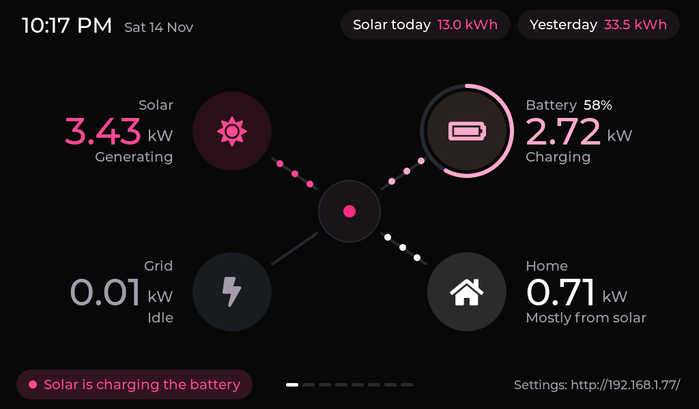
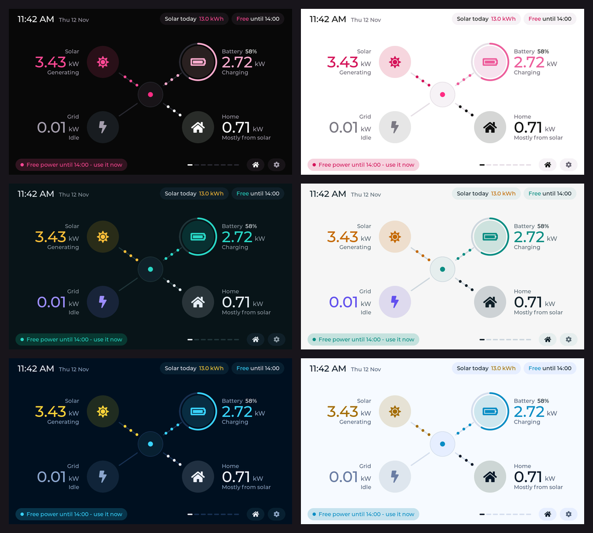

# GridCheck Screen

A wall display for **Sigenergy** solar and battery systems, running on the **Waveshare ESP32-S3-Touch-LCD-7B** (7", 1024×600). It reads your inverter over Modbus TCP on your own Wi-Fi: no cloud, no account, no PC once it's installed.



*Rendered from the firmware's own screen code on a PC (see `sim/`), not a photo of the board.*

## Install

**[Install page](https://mrdinte.github.io/GridCheck_Screen/)**: open it in Chrome or Edge on a computer, plug the board's **UART** USB-C port in and press **Install GridCheck**.

- **New screen:** tick **Erase device**.
- **Already running GridCheck:** leave it unticked so your Wi-Fi and settings are kept.

Then join the **GridCheck-Setup** Wi-Fi from your phone to choose your home Wi-Fi and enter the inverter's IP address. Modbus TCP must be switched on for the inverter (your installer does this in the mySigen app).

## Updates over Wi-Fi

From version **0.5.0** on, the screen updates itself over Wi-Fi. Install 0.5.0 or later over USB **once**; after that:

- The screen checks this site twice a day for a newer version. It **never installs on its own**.
- To install, either:
  - tap **Firmware** on the screen's **Settings & info** page, then tap again to confirm; or
  - press **Install update** on the phone settings page (the address is shown at the bottom of the screen).
- The phone page can also install a firmware file you downloaded (the one ending in `-app.bin`).
- Settings and history are kept. If a new version doesn't start properly, the screen goes back to the previous one by itself.

### Security

- **Signed updates.** Every update must be signed with GridCheck's private key, which is not in this repository. The screen checks the signature against the public key built into its firmware (`src/signing_pub.h`) before it will switch over. A file that is unsigned, signed with another key, or changed by even one bit is refused. That holds even if someone gets into this GitHub account, or uploads a file from inside your network.
- **Nothing is opened to the internet.** The screen only makes outgoing HTTPS requests (certificate checked) to this site and to Open-Meteo for the forecast. Nothing outside your network can connect to it.
- **Set a settings PIN** on the phone page. It protects changing settings and installing updates from your home network.
- **No updates through the setup hotspot.** The `GridCheck-Setup` hotspot has no password, so the screen refuses firmware through it.
- **Read-only.** The screen only *reads* the inverter (Modbus function 4). It never sends commands to it.
- **USB is physical access.** Anyone holding the board can re-flash it over USB. As with any device in your home, keep it where you'd keep your router.

## What it shows


Swipe between eight pages:

1. **Now**: solar, battery, grid and home power around a hub, with moving dots, the battery ring and a status line.
2. **Today**: solar made, home used, % self-powered, grid in/out, battery in/out, and where your solar went.
3. **Solar vs forecast**: today's solar against the Open-Meteo forecast (or your 7-day average), with yesterday and tomorrow.
4. **Spent & earned**: dollars spent on grid power and earned from export per day, for 7 or 30 days.
5. **Energy flow**: a Sankey diagram of where energy came from and went, for today, 7 or 30 days.
6. **Battery**: charge ring, time to full or empty, stored kWh, today in/out, reserve, health and temperature.
7. **History**: the last 24 hours of power, or daily totals for 7 or 30 days.
8. **Settings & info**: phone settings address, Wi-Fi, inverter connection, firmware updates, and buttons for **Colours**, **screen timeout** and **Reset all** (hold 5 s).



The **phone settings page** (served by the screen) covers:
- Wi-Fi.
- Inverter IP, port and plant id.
- Demo mode.
- Time zone.
- Colours (GridCheck, Classic, Ocean) and brightness.
- **Screen dimming**: after a set time without a touch, and overnight.
- **Power prices**: feed-in, supply charge, and **time of use**: up to 6 named periods (Off-peak, Shoulder, Peak, Free...) with times, weekdays/weekends and prices, plus a price for all other times.
- Forecast location and panel size.
- Firmware updates.
- An optional PIN.

History (one sample a minute for 24 hours, and one record a day for 13 months) is kept in the board's own flash.

## Version history

- **0.6.0**: time-of-use prices: named periods (Off-peak, Shoulder, Peak, Free...) with times, days and prices; the screen shows the price now and when it changes, and says when power is free or at its dearest. Calmer moving dots. Installs over Wi-Fi from 0.5.0.
- **0.5.0**: signed updates over Wi-Fi (from this site or a file), with automatic roll-back. Needs one USB install; history starts afresh because the flash layout changed (settings are kept).
- **0.4.0**: three colour palettes and screen dimming.
- **0.3.0**: all eight pages, prices, forecast, history storage, and the GridCheck look.
- **0.2.0**: ESP-IDF 5 rebuild that stopped the screen flicker.
- **0.1.0**: first version.

## Build it yourself

Needs [PlatformIO](https://platformio.org/) (ESP-IDF 5.3, not Arduino) and `pip install cryptography`.

```bash
pio run                  # build
pio run -t upload        # flash over USB
pio device monitor       # log, 115200 baud
sh tools/package.sh      # build, sign and write docs/firmware/ (install page + ota.json)
```

Screens running the official firmware only accept updates signed with the official key. To build and update your own, make your own key and build its public key into the firmware, then install that build over USB once:

```bash
python3 tools/sign.py newkey keys/signing_key.pem        # keep keys/signing_key.pem secret
python3 tools/sign.py header keys/signing_key_pub.pem src/signing_pub.h
```

Point the screen's **Update address** (phone page) at your own `ota.json` to update from your own site.

- `sim/` renders the real screen code on a PC into PNGs: `sh sim/build.sh && sh sim/render.sh`, after one `pio run`.
- `tools/make_fonts.sh` regenerates the fonts.
- `tools/make_lv_conf.py` regenerates `include/lv_conf.h`.

## Licence

MIT (see `LICENSE`). Third-party parts are listed in `THIRD_PARTY.md`.
